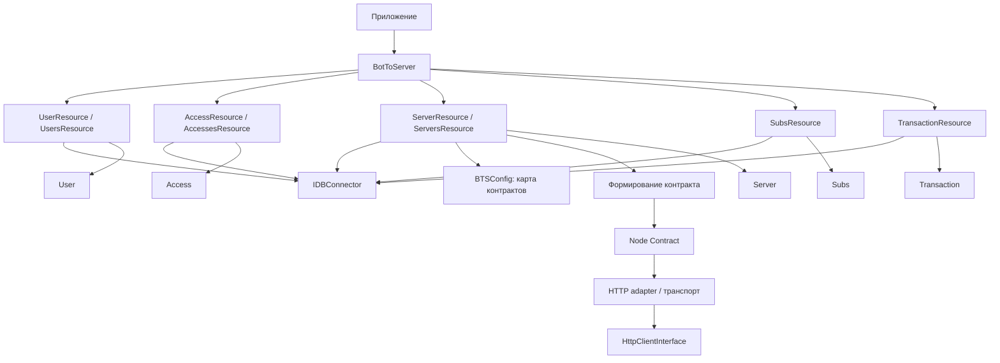
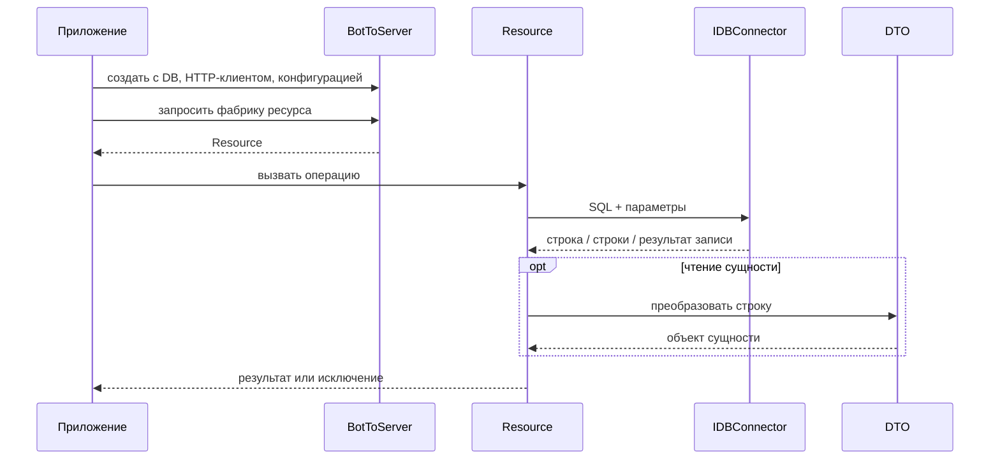
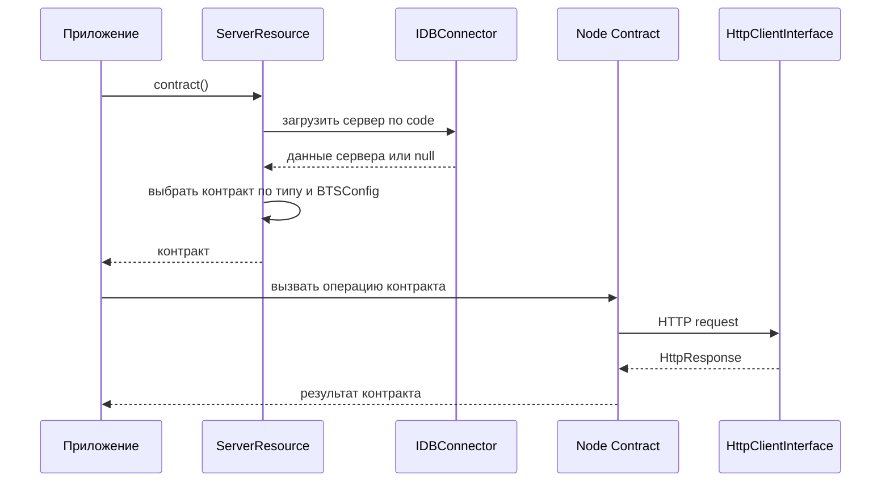

# Архитектура BTS v3 (BotToServer)

## Назначение

BTS (BotToServer) — PHP-библиотека для работы с данными пользователей, VPN-доступов, серверов, коротких ссылок/подписок и платёжных транзакций, а также для обращения к VPN-нодам через контракты. Центральная точка сборки — фасад `BotToServer`: он получает инфраструктурные зависимости и предоставляет фабрики ресурсов.

Библиотека разделяет три задачи:

- **Resources** выполняют операции предметной области и чтение/запись записей через `IDBConnector`.
- **DTO** (`Types`) представляют строки сущностей в PHP-объектах.
- **Node Contracts** инкапсулируют протокол удалённого узла поверх HTTP-клиента.

Библиотека не подменяет приложение: выбор сценария, авторизация вызывающего пользователя, политики оплаты и запуск бизнес-процессов остаются ответственностью интегрирующего кода, если конкретная реализация явно не говорит обратного.

## Архитектурные принципы

1. **Явные зависимости.** Фасад получает DB-коннектор, HTTP-клиент и конфигурацию. Resources используют переданные зависимости, а не создают инфраструктуру самостоятельно.
2. **Узкие границы.** Ресурс отвечает за операции над одной областью данных; интерфейс коннектора — за выполнение SQL; контракт узла — за удалённые команды.
3. **Параметризованный SQL.** Проверенные тестами запросы передают значения отдельным массивом параметров. Для динамических условий серверов используется проверка допустимых полей.
4. **DTO вместо сырых строк результата.** Для основных сущностей тестами подтверждено преобразование строк БД в объекты типов. Не все коллекционные методы одинаково именованы.
5. **Подключаемость контрактов.** `BTSConfig` содержит карту типов серверов и классов контрактов. Для неизвестного типа тестами подтверждён безопасный `NullContract`.
6. **Отсутствие скрытых обещаний.** Публичные методы документируются по подтверждённому поведению; детали, не видимые в тестах, оставлены для будущей API Reference.

## Слои и связи

Схема показывает подтверждённые роли компонентов, но не заявляет, что каждый вызов ресурса проходит через HTTP. Тесты фасада подтверждают, что базовые операции чтения ресурсов могут выполняться только через DB.

## Фасад `BotToServer`

Фасад создаётся с `IDBConnector`, `HttpClientInterface` и `BTSConfig`. По доступным тестам он предоставляет фабрики:

- `user($identifier, UserType $type)` → `UserResource`;
- `users()` → `UsersResource`;
- `access($uuid)` → `AccessResource`;
- `accesses($userId)` → `AccessesResource`;
- `server($code)` → `ServerResource`;
- `servers()` → `ServersResource`;
- `subs()` → `SubsResource`.

Для транзакций класс `TransactionResource` подтверждён отдельными тестами, однако наличие соответствующей фабрики в `BotToServer` из доступных материалов не установлено. До проверки исходников не следует обещать фабричный метод `transaction()`/`transactions()`.

Фасад не означает автоматического выполнения транзакции БД или сетевого запроса при создании ресурса. Например, проверочные тесты показывают, что `user()->exists()`, `users()->getAll()`, `access()->exists()`, `accesses()->list()`, `server()->info()`, `servers()->getAll()` и `subs()->get()` используют DB, а HTTP-вызов не выполняется.

## Resources и подтверждённые операции

Ниже перечислены имена методов, присутствующие в доступных тестах. Это не полный каталог публичного API.

### Пользователи: `UserResource` и `UsersResource`

`UserResource` привязан к идентификатору и `UserType` (в тестах встречаются `TELEGRAM` и `EMAIL`). Подтверждены операции:

- `exists()` — проверяет идентификатор пользователя;
- `get()` — находит пользователя и возвращает `User` либо `null`;
- `create('ru'[, username])` — создаёт запись; повторное создание существующего пользователя приводит к `UserAlreadyExistsException`;
- `update(...)` — обновляет переданные поля; отсутствие изменений не выполняет запись и возвращает `false`;
- `updatePayment(DateTimeInterface, DateTimeInterface)` — обновляет активность, дату платежа и срок действия; тест фиксирует два последовательных DB-вызова;
- `touch()`, `block()`, `unblock()`, `drop()` — операции состояния.

`UsersResource` поддерживает `getAll()`, `dropped()`, `expiredBefore($date)` и `expiresBetween($start, $end)`. Результаты преобразуются в массив `User`. В тестах активная выборка исключает помеченные как удалённые записи; `dropped()` выбирает удалённые.

`null` при обновлении означает пропуск поля, тогда как пустая строка и ноль сохраняются как допустимые значения — это поведение зафиксировано тестами частичных обновлений.

### Доступы: `AccessResource` и `AccessesResource`

`AccessResource($uuid)` подтверждает методы:

- `exists()`;
- `get()` → `Access`, при отсутствии выбрасывает `AccessNotFoundException`;
- `create($userId, $type, $serverId[, $name])`;
- `update($name)`;
- `block()`, `unblock()`, `drop()`.

`AccessesResource($userId)` подтверждает `list(?$type = null)` и `count(?$type = null)`. Список преобразуется в `Access[]`. Фильтр типа добавляется только при переданном значении; тест также проверяет пустую строку как явно переданное значение.

### Серверы: `ServerResource` и `ServersResource`

`ServersResource` подтверждает методы `getAll()`, `filterBy($filters)`, `create(...)`, `update(...)` и `updateStatus($code, ServerStatusType $status)`. Список/фильтры возвращают `Server[]`. Допустимые поля динамического фильтра ограничиваются реализацией; неизвестные поля не попадают в SQL. Пустое обновление не вызывает DB.

Тестами подтверждены статусы `ACTIVE`, `DRAINING`, `DISABLED`, `MAINTENANCE`; для отключающих состояний устанавливается `disabled_at`, для остальных очищается. Попытка установить `DROPPED` через `updateStatus` в проверенном сценарии не выполняет DB-запрос и возвращает `false`.

`ServerResource($code)` предоставляет `info()` и `contract()`. `info()` возвращает `Server` или `null`. `contract()` подбирает контракт по типу сервера и конфигурации; если тип неизвестен, используется `NullContract`. Для известного `openvpn` тесты подтверждают создание `OpenVPNContract`. Другие реализации и их протоколы без проверки исходников здесь не описываются.

### Подписки: `SubsResource`

Подтверждены `get($shortCode)`, `create($shortCode, $serverId, $accessId)`, `update($oldShortCode, $newShortCode)`, `setUsed($shortCode)` и `drop($shortCode)`. `get()` возвращает `Subs` или `null`. Тесты подтверждают, что обычное получение исключает `is_dropped = 1`; операция удаления устанавливает этот признак.

Класс `SubsContract` из тестов также формирует ссылку: `getSubsLink($shortCode)` возвращает `null`, если запись не найдена, и URL с кодом, если найдена; `createSubsLink(...)` возвращает ссылку при ненулевом ID вставленной записи. Это отдельная контрактная/сервисная роль, не следует путать её с `SubsResource`.

### Транзакции: `TransactionResource`

Отдельные тесты подтверждают следующие методы:

- `create($userId, $provider, $amount, $currency = 'RUB', $providerPaymentId = null, $durationDays = null, $description = null, $metadata = null)`;
- `get($id)`, `getByProviderPayment($provider, $paymentId)`, `getByUserId($userId)`;
- `update($id, ...переданные поля)`;
- `success($id)`, `cancel($id)`, `failed($id)`, `refunded($id)`.

Чтение одной записи возвращает `Transaction` или `null`, а выборка пользователя — массив DTO. Метаданные кодируются в JSON при записи и декодируются при чтении. Некорректные для JSON данные вызывают `JsonException` до DB-записи. Тесты подтверждают статусы `succeeded`, `canceled`, `failed`, `refunded`; `success()` также записывает `paid_at`. Пустой `update()` не выполняет SQL. Ошибки коннектора пробрасываются вызывающему коду.

Порядок и точные имена аргументов следует сверить с исходной сигнатурой при подготовке API Reference: тесты подтверждают фактические вызовы, но не заменяют объявление метода.

## DTO (`Types`)

DTO предназначены для представления сущностей библиотеки. Доступные тесты проверяют поля и преобразование скалярных DB-значений в типы PHP (например, числовые идентификаторы/флаги и даты).

- **`User`**: идентификатор, Telegram/email идентификаторы, `username`, `language`, даты активности, платежа и срока действия, флаги активности/удаления и `disabled_at`.
- **`Access`**: `id`, `user_id`, `uuid`, тип, `server_id`, дата создания, флаги состояния и `disabled_at`.
- **`Server`**: `id`, `code`, `name`, `host`, `port`, API endpoint, зашифрованный секрет, тип, URL подписок, даты, статус и признаки удаления.
- **`Subs`**: `id`, `short_code`, `server_id`, `access_id`, дата создания, признак использования, `used_at` и признак удаления.
- **`Transaction`**: ID пользователя, провайдер и ID платежа, денежная сумма как строка, валюта, статус, длительность, описание, JSON metadata и даты.

Точные типы свойств, конструкторы, неизменяемость и правила преобразования не следует считать исчерпывающе описанными этим списком. Они должны быть взяты из исходников и отражены в будущей API Reference.

## Слой хранения: `IDBConnector`

Resources зависят от интерфейса `IDBConnector`, а не от конкретной базы/драйвера. Доступные тесты подтверждают методы, используемые ресурсами:

- `fetchOne($sql, $params)` — одна строка либо `null`;
- `fetchAll($sql, $params)` — массив строк;
- `execute($sql, $params)` — результат записи как boolean в проверенных сценариях;
- `insert($sql, $params)` — ID/результат вставки в проверенных сценариях.

Тестовые дополнения содержат интеграционные проверки `PDOConnector` и поведения запроса в транзакции, однако объявление интерфейса и точные методы `begin/commit/rollback` из текущего зеркала недоступны. Поэтому названия и семантика API транзакций намеренно не приводятся. Не предполагается, что каждый публичный метод ресурса сам открывает транзакцию: такой контракт следует проверять по реализации.

## HTTP: `HttpClientInterface` и `HttpResponse`

Контрактные тесты показывают, что `HttpClientInterface` используется адаптером с методом `request(method, endpoint, options, headers)` и возвращает `HttpResponse`; тесты также ожидают метод `stream`, но его сигнатура и назначение здесь не подтверждены. Фактические типы аргументов и полный интерфейс требуют сверки с исходниками.

Подтверждённые свойства `HttpResponse`:

- содержит HTTP status code, headers и body;
- `isSuccessful()` считает успешными коды от 200 до 299;
- предоставляет `getStatusCode()`, `getBody()`, `getHeaders()`, `hasHeader()`, `getHeader()`, `getHeaderLine()` и `getJsonBody()`;
- при отсутствующем заголовке `hasHeader()` возвращает `false`, `getHeader()` — пустую строку.

Тесты OpenVPN-адаптера подтверждают JSON-форму запроса и получение свежего Bearer-токена для каждого вызова. Транспортные исключения передаются вызывающему коду. Это наблюдаемое поведение адаптера, а не гарантия для любого клиента/контракта.

## Конфигурация: `BTSConfig`

Тестами подтверждены поля `encryptionKey`, `role`, `audCode`, `configsDir`, `logsDir` и карта `contracts`. Пять основных значений могут браться из окружения (`BTS_ENCRYPTION_KEY`, `BTS_ROLE`, `BTS_AUD_CODE`, `CONFIGS_DIR`, `LOGS_DIR`) либо задаваться явными аргументами. Пустое значение обязательного поля приводит к `InvalidArgumentException`.

Карта контрактов по умолчанию содержит `openvpn` → `OpenVPNContract`; пользовательские элементы объединяются с дефолтами. Подтверждённые тестами Env-хелперы читают значения окружения с приведением к строке, целому, числу с плавающей точкой и boolean; некорректное значение вызывает `UnexpectedValueException`.

Несмотря на наличие `configsDir` и `logsDir`, доступные тесты не позволяют утверждать, что BTS автоматически настраивает файловое логирование или управляет конфигурационными файлами при каждом запросе.

## Контракты VPN-нод и расширение

В тестах обнаружены `OpenVPNFuncAdapter`, `OpenVPNContract`, отдельные `AccessContract`, `ActiveContract`, `SubsContract`, а также `NullContract`. Это подтверждает наличие OpenVPN-ориентированной интеграции в тестируемом наборе.

`VPNNodeContractInterface` как точное имя интерфейса в доступных материалах не найдено. Оно может быть частью исходников, но до проверки реализации его нельзя представлять как подтверждённый символ публичного API. Аналогично не найдено подтверждение реализованного Xray-контракта. Этот документ не обещает их наличие.

Документированная точка расширения, подтверждённая тестами, — карта `BTSConfig::$contracts` и выбор класса по типу сервера. Точные требования к конструктору/методам подключаемого класса необходимо сверить с контрактом в исходниках. `NullContract` служит заглушкой для неподдерживаемого типа; проверенный случай не выполняет сетевой запрос.

## Шифрование секрета: `SecretCipher`

Тесты подтверждают статические операции `generateKey()`, `decodeKey($key)`, `encrypt($plaintext, $key)` и `decrypt($ciphertext, $key)`. Ключ декодируется в 32 байта; неверный ключ приводит к `InvalidArgumentException`. Шифрование обратимо, рандомизировано (повторное шифрование того же открытого текста даёт другое значение), поддерживает пустую строку, Unicode и бинарные данные. Неверный или изменённый ciphertext и неправильный ключ приводят к `RuntimeException`.

По заданному контексту проекта применяется AES-256-GCM. Доступные тесты подтверждают аутентифицированное поведение (изменённый ciphertext/неверный ключ отвергаются), но формат сериализации nonce/tag/ciphertext и точный формат ключа нужно описать после сверки с кодом. Секреты и ключи не следует записывать в логи приложения.

В тестах также присутствует `JWTCipher` для OpenVPN-аутентификации, включая claims и проверку срока действия. Это вспомогательная функциональность реализации контракта, а не часть заявленного API фасада; полный протокол и настройки JWT здесь не фиксируются.

## Исключения и ошибки

Подтверждённые имена/случаи:

- `UserAlreadyExistsException` — попытка создать уже существующего пользователя;
- `AccessNotFoundException` — `AccessResource::get()` не находит доступ;
- `InvalidArgumentException` — некорректная конфигурация или ключ;
- `UnexpectedValueException` — некорректное значение переменной окружения;
- `JsonException` — невозможность сериализовать metadata транзакции;
- `RuntimeException` — невозможность расшифровать/проверить ciphertext;
- ошибки DB и транспорта в проверенных сценариях не поглощаются.

Это перечень наблюдаемых случаев, не полный каталог исключений. Не следует предполагать единый базовый класс или стабильную иерархию до проверки исходников.

## Жизненный цикл вызова

Типичный вызов ресурса проходит следующие этапы:

Для обращения к ноде отдельная последовательность выглядит так:

Подробности создания авторизационных данных, расшифрования секрета и построения URL зависят от конкретного контракта; диаграмма не навязывает их одинаковый порядок.

## Границы ответственности

| Компонент | Ответственность | Не следует приписывать без проверки |
|---|---|---|
| `BotToServer` | Сборка и выдача ресурсов с общими зависимостями | Автоматические миграции, управление соединением, бизнес-процессы |
| Resource | Операции своей предметной области, DB-вызовы, отображение данных | Сценарии приложения и транзакционность всех операций |
| `IDBConnector` | Выполнение SQL и возврат результатов | Выбор схемы/миграций или скрытые повторы запросов |
| DTO | Представление записей | Валидация/сохранение, если это не видно в реализации |
| Node Contract | Протокол удалённого узла | Общая поддержка всех VPN-серверов |
| `HttpClientInterface` | Транспортный вызов | Повтор запроса, retry/backoff, логирование |
| `BTSConfig` | Значения конфигурации и карта контрактов | Управление жизненным циклом файлов/логов |
| Приложение | Авторизация, orchestration, продуктовые решения | — |

В контексте проекта **Manager отложен и не входит в действующий API**. Не проектируйте примеры и диаграммы так, будто такой слой уже доступен. Подключение PSR-3 logging было откачено: библиотеке не следует приписывать PSR-3 logger, его обязательную настройку или гарантированные события логирования.

